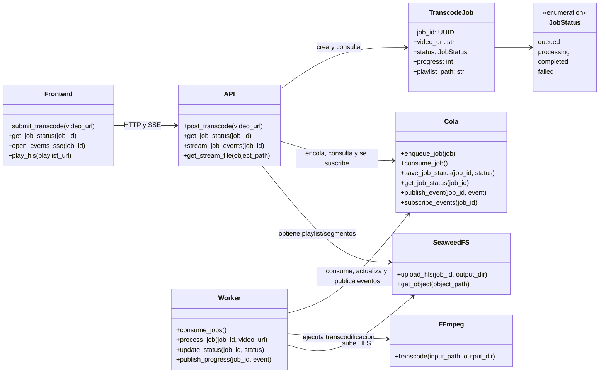

# Documentacion tecnica y bitacora del proyecto

> Servicio de transcodificacion bajo demanda a HLS con Python, Redis, FFmpeg, Docker y SeaweedFS.
> Este archivo recopila las decisiones, pruebas, comandos y disenos acordados hasta el 19 de noviembre de 2026.
> Es una bitacora de trabajo; no sustituye al README, que se completara al final.

## 1. Objetivo y alcance previsto

El proyecto recibira una URL de video, aceptara el trabajo de forma asincrona, lo procesara con FFmpeg y almacenara la salida HLS para que el navegador pueda reproducirla.

Alcance inicial acordado:

- Un host con Docker Compose.
- Python y FastAPI para la API; HTML, CSS y JavaScript para el frontend.
- Redis para la cola, los estados de los trabajos y el intercambio de eventos.
- Un worker que procesa un trabajo a la vez.
- FFmpeg en un contenedor efimero.
- SeaweedFS local para almacenar la playlist y los segmentos HLS mediante su API compatible con S3.
- Una sola salida/resolucion HLS en la primera version.
- Sin un sistema avanzado de reintentos de trabajos.
- SSE para enviar logs, progreso y cambios de estado al navegador.

## 2. Estado actual

### Validado

- Se eligieron Python/FastAPI, HTML/CSS/JavaScript, Redis, FFmpeg y SeaweedFS.
- Se reviso el diseno del flujo y el diagrama de clases; las versiones Mermaid mas abajo reconstruyen los acuerdos.
- Se construyo la imagen `local/ffmpeg-transcoder:dev` desde Ubuntu 22.04.
- La imagen incluye FFmpeg 4.4.2 y los codificadores `libx264` y `aac`.
- Una prueba sintetica de 12 segundos genero `playlist.m3u8` y dos segmentos `.ts` accesibles desde Windows mediante un bind mount.
- Redis se inicio con Docker Compose; el `PING` desde Python devolvio `True`.
- El worker de la rama `feature/worker-redis` recibio un mensaje de prueba y mostro su `job_id` y URL.
- El worker captura `redis.exceptions.TimeoutError` y `redis.exceptions.ConnectionError` durante `BLPOP`, espera dos segundos y vuelve a intentar.
- Se instalaron las dependencias de API en el entorno virtual local.

### Todavia no implementado o no verificado

- La API FastAPI no se ha ejecutado ni se han probado sus endpoints.
- El codigo de API que se incluye mas adelante es un borrador propuesto; no se ha guardado como `API/main.py`.
- El worker descarga videos, ejecuta FFmpeg, sube HLS a SeaweedFS y guarda en Redis el estado y la URL de la playlist.
- Se proceso un trabajo real hasta `completed`; la playlist y los segmentos se reprodujeron en VLC.
- La interfaz Filer de SeaweedFS se abrio desde el navegador y mostro la playlist y sus segmentos.
- No se ha implementado el endpoint SSE ni la entrega de HLS desde la API.
- El frontend y la prueba completa de extremo a extremo siguen pendientes.
- El worker de `feature/worker-redis` aun no esta en `develop`: el PR #1 estaba abierto y no fusionado en la ultima comprobacion.

## 3. Componentes y responsabilidades

| Componente | Responsabilidad prevista |
|---|---|
| Frontend | Enviar una URL, mostrar estado/progreso y reproducir HLS. |
| API (FastAPI) | Validar y aceptar trabajos, consultar estados, retransmitir eventos SSE y servir objetos HLS. |
| Redis | Mantener la lista `transcode_jobs`, los estados por `job_id` y los eventos entre worker y API. |
| Worker | Consumir trabajos, preparar la entrada, lanzar FFmpeg, actualizar estados y publicar progreso. |
| FFmpeg | Convertir el video de entrada en una playlist HLS y segmentos. No incluye Redis ni almacenamiento de objetos. |
| SeaweedFS | Guardar la playlist `.m3u8` y cada segmento `.ts` mediante su API S3. |

### Redis: cola y registro de trabajo

La lista `transcode_jobs` representa los trabajos pendientes. El mensaje de prueba tuvo el formato:

```json
{
  "job_id": "prueba-001",
  "video_url": "https://example.invalid/video.mp4"
}
```

La URL `.invalid` se uso como marcador: el worker actual solo imprime el mensaje y no intenta descargarlo.

El estado y los datos del trabajo se guardaran aparte de la lista, por ejemplo, en un hash Redis con la clave `job:<job_id>`:

```python
client.hset(
    f"job:{job_id}",
    mapping={"status": "queued", "video_url": video_url},
)
job_data = client.hgetall(f"job:{job_id}")
```

Estados definidos: `queued`, `processing`, `completed` y `failed`. La API crea `queued`; el worker debera actualizar los estados durante el procesamiento. No se debe marcar `completed` hasta que FFmpeg haya generado HLS y la salida se haya guardado correctamente.

## 4. Diagrama 1: flujo previsto

El siguiente diagrama Mermaid reconstruye el flujo acordado a partir de las revisiones. El SSE es una conexion que permanece abierta; no es una consulta repetida del frontend.

```mermaid
flowchart TD
    FE[Frontend / navegador] -->|POST /transcode con video_url| API[API FastAPI]
    API --> VALIDAR{URL valida?}
    VALIDAR -->|No| ERROR[Respuesta de validacion 4xx]
    VALIDAR -->|Si| CREAR[Crear job_id y estado queued]
    CREAR --> REDIS[(Redis: cola, estados y eventos)]
    API -->|202 Accepted: job_id y queued| FE

    REDIS -->|BLPOP: entrega trabajo| WORKER[Worker]
    WORKER -->|Actualizar a processing| REDIS
    WORKER --> TEMP[Descargar entrada a almacenamiento temporal]
    TEMP --> FFMPEG[Contenedor efimero con FFmpeg]
    FFMPEG --> RESULTADO{HLS generado correctamente?}

    RESULTADO -->|No| FAILED[Marcar estado failed]
    FAILED --> LIMPIAR[Limpiar archivos temporales]
    LIMPIAR --> REDIS

    RESULTADO -->|Si| SUBIR[Subir playlist y segmentos a SeaweedFS]
    SUBIR --> COMPLETED[Marcar completed y guardar ruta de playlist]
    COMPLETED --> REDIS

    FE -->|GET /jobs/{job_id}: estado actual| API
    API -->|Leer estado y progreso| REDIS
    REDIS --> API
    API --> FE

    FE -->|GET /jobs/{job_id}/events: abrir una vez| API
    WORKER -->|Publicar logs, progreso y estado| REDIS
    REDIS -->|Eventos para la suscripcion de API| API
    API -->|Eventos SSE por conexion abierta| FE

    FE -->|GET /stream/{path}: playlist o segmento| API
    API -->|get_object(object_path)| SEAWEEDFS[(SeaweedFS S3)]
    SEAWEEDFS -->|Contenido del objeto| API
    API -->|Playlist .m3u8 o segmento .ts| FE
```

## 5. Diagrama 2: clases/componentes previstos

Este diagrama es una representacion conceptual de las responsabilidades revisadas. No implica que todas estas clases u operaciones ya esten implementadas.



## 6. Contrato de API acordado y punto por resolver

El diseno de los diagramas define estos endpoints:

| Endpoint | Proposito | Respuesta prevista |
|---|---|---|
| `POST /transcode` | Recibir `video_url`, crear y encolar el trabajo. | `202 Accepted` con `job_id` y `status: "queued"`. |
| `GET /jobs/{job_id}` | Consultar una fotografia del estado actual. | `200` con `job_id`, `status` y `progress`; al completar, incluir `playlist_url`; `404` si no existe. |
| `GET /jobs/{job_id}/events` | Mantener una conexion SSE abierta para novedades. | Eventos `progress`, `log` y `status`; cerrar al terminar en `completed` o `failed`. |
| `GET /stream/{path}` | Entregar desde SeaweedFS la playlist o un segmento referenciado por ella. | Contenido del objeto; `404` si el objeto no existe. |

**Ruta pendiente de unificar:** el codigo de ejemplo propuesto mas abajo usa `POST /jobs`, mientras que el contrato de los diagramas usa `POST /transcode`. El codigo aun no se implemento; elegir una sola ruta antes de comenzar la API.

SSE es de la API al navegador. El worker publica eventos en Redis; la API se suscribe y los envia por la conexion SSE. El worker no se comunica directamente con el navegador.

## 7. Codigo actual del worker

Este es el consumidor inicial que se subio en la rama `feature/worker-redis`. Consume un mensaje de Redis, imprime sus campos y reintenta ante errores de timeout/conexion durante `BLPOP`. Todavia no procesa el video.

```python
import json
import os
import time

import redis


REDIS_HOST = os.getenv("REDIS_HOST", "localhost")
REDIS_PORT = int(os.getenv("REDIS_PORT", "6379"))
QUEUE_NAME = os.getenv("REDIS_QUEUE", "transcode_jobs")


def main():
    client = redis.Redis(
        host=REDIS_HOST,
        port=REDIS_PORT,
        decode_responses=True,
    )
    client.ping()
    print(f"Worker escuchando la cola {QUEUE_NAME}")

    while True:
        try:
            job_item = client.blpop(QUEUE_NAME, timeout=0)
        except (redis.exceptions.TimeoutError, redis.exceptions.ConnectionError) as error:
            print(f"Conexión con Redis interrumpida: {error}. Reintentando en 2 segundos.")
            time.sleep(2)
            continue

        _, raw_job = job_item
        job = json.loads(raw_job)
        print(f"Trabajo recibido: {job['job_id']}")
        print(f"URL fuente: {job['video_url']}")


if __name__ == "__main__":
    main()
```

`BLPOP(..., timeout=0)` espera indefinidamente en Redis. La cola vacia no es por si sola un error. El `TimeoutError` observado fue un timeout de lectura del socket; sin el `try/except` el proceso terminaba. Con el manejo actual espera dos segundos y reintenta. Redis y el worker son procesos separados: esto no deja bloqueada una solicitud de la API, pero si el worker se detuviera, los trabajos podrian quedar sin procesar.

### Dependencias

`Worker/requirements.txt`:

```text
redis
docker
minio
requests
```

El paquete Python `minio` es el cliente S3 usado por el worker para conectarse a SeaweedFS; no se ejecuta ni se configura un servidor MinIO.

`API/requirements.txt`:

```text
fastapi
uvicorn
redis
```

La API solo tiene sus dependencias instaladas; no se ha confirmado un `main.py` ni una ejecucion de Uvicorn.

## 8. Borrador de API propuesto (no implementado)

Este codigo se propuso para guardar el estado inicial en Redis y exponer una consulta. Es una base didactica, no esta probada ni guardada como `API/main.py`. Ademas, usa `POST /jobs`; ver el punto de rutas pendiente en la seccion anterior.

```python
import json
import os
from uuid import uuid4

import redis
from fastapi import FastAPI, HTTPException, status
from pydantic import BaseModel, HttpUrl


REDIS_HOST = os.getenv("REDIS_HOST", "localhost")
REDIS_PORT = int(os.getenv("REDIS_PORT", "6379"))
QUEUE_NAME = os.getenv("REDIS_QUEUE", "transcode_jobs")

redis_client = redis.Redis(
    host=REDIS_HOST,
    port=REDIS_PORT,
    decode_responses=True,
)

app = FastAPI(title="Servicio de transcodificacion")


class CreateJobRequest(BaseModel):
    video_url: HttpUrl


@app.post("/jobs", status_code=status.HTTP_202_ACCEPTED)
def create_job(request: CreateJobRequest) -> dict[str, str]:
    job_id = str(uuid4())
    video_url = str(request.video_url)
    job = {"job_id": job_id, "video_url": video_url}

    try:
        with redis_client.pipeline(transaction=True) as pipe:
            pipe.hset(
                f"job:{job_id}",
                mapping={
                    "job_id": job_id,
                    "video_url": video_url,
                    "status": "queued",
                },
            )
            pipe.rpush(QUEUE_NAME, json.dumps(job))
            pipe.execute()
    except redis.exceptions.RedisError as error:
        raise HTTPException(
            status_code=status.HTTP_503_SERVICE_UNAVAILABLE,
            detail="Redis no esta disponible.",
        ) from error

    return {"job_id": job_id, "status": "queued"}


@app.get("/jobs/{job_id}")
def get_job(job_id: str) -> dict[str, str]:
    try:
        job = redis_client.hgetall(f"job:{job_id}")
    except redis.exceptions.RedisError as error:
        raise HTTPException(
            status_code=status.HTTP_503_SERVICE_UNAVAILABLE,
            detail="Redis no esta disponible.",
        ) from error

    if not job:
        raise HTTPException(
            status_code=status.HTTP_404_NOT_FOUND,
            detail="No se encontro ese trabajo.",
        )

    return job
```

Una vez que exista y su ruta se unifique con el contrato, el comando propuesto para levantarla desde la raiz del proyecto es:

```powershell
.\.venv\Scripts\python.exe -m uvicorn main:app --app-dir .\API --reload
```

La documentacion interactiva de FastAPI estaria en `http://127.0.0.1:8000/docs`.

## 9. Dockerfile y SeaweedFS

### Imagen de FFmpeg

Contenido de `Dockerfile.FFMPEG`:

```dockerfile
FROM ubuntu:22.04

RUN apt-get update && apt-get install -y --no-install-recommends ffmpeg && rm -rf /var/lib/apt/lists/*
```

La imagen se construye localmente; no se publica automaticamente:

```powershell
docker build -f Dockerfile.FFMPEG -t local/ffmpeg-transcoder:dev .
docker run --rm local/ffmpeg-transcoder:dev ffmpeg -version
docker run --rm local/ffmpeg-transcoder:dev ffmpeg -hide_banner -encoders
```

### Prueba sintetica HLS y bind mount en Windows

Los siguientes comandos se ejecutan en PowerShell desde la raiz del proyecto. Se crea una carpeta temporal fuera del repositorio y se conserva la salida aunque el contenedor se elimine con `--rm`.

```powershell
$output = Join-Path $env:TEMP "ffmpeg-hls-test"
New-Item -ItemType Directory -Force -Path $output | Out-Null

docker run --rm --mount "type=bind,source=$output,target=/output" local/ffmpeg-transcoder:dev ffmpeg -hide_banner -f lavfi -i "testsrc=size=640x360:rate=25" -f lavfi -i "sine=frequency=1000:sample_rate=44100" -t 12 -c:v libx264 -pix_fmt yuv420p -c:a aac -f hls -hls_time 10 -hls_list_size 0 -hls_segment_filename "/output/segment_%03d.ts" "/output/playlist.m3u8"

Get-ChildItem -LiteralPath $output
Get-Content -LiteralPath (Join-Path $output "playlist.m3u8")
explorer $output
```

Resultado verificado: `playlist.m3u8`, `segment_000.ts` de aproximadamente 10 segundos y `segment_001.ts` de aproximadamente 2 segundos; la playlist termina con `#EXT-X-ENDLIST`. La carpeta de prueba se podia eliminar con el siguiente comando, solo despues de confirmar que `$output` apunta a la carpeta temporal correcta:

```powershell
Remove-Item -LiteralPath $output -Recurse
```

`Docker-compose.yml` define SeaweedFS y Redis. SeaweedFS expone su API S3 en `127.0.0.1:8333` y la interfaz Filer en `127.0.0.1:8888`; ambos puertos quedan limitados a la maquina local. Sus datos persisten en el volumen `seaweedfs_data`.

La configuracion local se carga desde el `.env` ignorado por Git. El bucket `hls-output` contiene objetos bajo `jobs/<job_id>/`, incluyendo `playlist.m3u8` y los segmentos `.ts`. Para explorar los objetos en el navegador, abrir `http://127.0.0.1:8888/buckets/hls-output/`.

Se valido `docker compose config --quiet`, la interfaz Filer respondio HTTP 200 y la URL de la playlist siguio respondiendo HTTP 200 despues de recrear SeaweedFS. El acceso anonimo de lectura habilitado para desarrollo no permite listar ni escribir objetos desde la API S3.

### Limpieza de Docker: comandos destructivos

Estos comandos se discutieron para limpiar un intento anterior. No son comandos rutinarios:

```powershell
docker compose down -v
docker compose down --rmi all -v
```

`down -v` elimina los volumenes de Compose y sus datos. Agregar `--rmi all` tambien elimina las imagenes usadas por Compose, incluida una imagen local que podria necesitarse reconstruir. Ejecutarlos solo si se desea borrar esos datos/imagenes.

## 10. Python, Redis y worker: comandos de uso y prueba

En Windows se uso `.venv` para aislar dependencias. La version comprobada del entorno fue Python 3.15.2. La activacion de PowerShell fue bloqueada por la politica de scripts; no se cambio esa politica. Se invoco siempre el interprete directamente.

```powershell
.\.venv\Scripts\python.exe --version
py -0p
```

Instalacion y comprobacion de dependencias:

```powershell
.\.venv\Scripts\python.exe -m pip install -r .\Worker\requirements.txt
.\.venv\Scripts\python.exe -c "import redis, docker, minio, requests; print('Dependencias disponibles')"
.\.venv\Scripts\python.exe -m pip install -r .\API\requirements.txt
```

`py -0p` lista los interpretes registrados en Windows; no instala ni modifica Python.

Iniciar solo Redis y verificarlo:

```powershell
docker compose -f Docker-compose.yml up -d redis
docker compose -f Docker-compose.yml ps redis
.\.venv\Scripts\python.exe -c "import redis; client=redis.Redis(host='localhost', port=6379, decode_responses=True); print(client.ping())"
```

Un resultado `True` confirma que Python pudo conectarse a Redis desde Windows.

Iniciar el worker desde la raiz del repositorio:

```powershell
.\.venv\Scripts\python.exe .\Worker\worker.py
```

Para encolar un unico trabajo ficticio desde una segunda terminal:

```powershell
.\.venv\Scripts\python.exe -c "import json, redis; r=redis.Redis(host='localhost', port=6379, decode_responses=True); print(r.rpush('transcode_jobs', json.dumps({'job_id': 'prueba-001', 'video_url': 'https://example.invalid/video.mp4'})))"
```

El numero devuelto por `RPUSH` es la longitud de la lista despues de agregar el elemento; no significa por si solo que el worker lo proceso. El worker confirma el consumo al imprimir `Trabajo recibido` y la URL.

Diagnostico de estado/cola y logs:

```powershell
.\.venv\Scripts\python.exe -c "import redis; r=redis.Redis(host='localhost', port=6379, decode_responses=True); print('PING:', r.ping()); print('Trabajos en cola:', r.llen('transcode_jobs')); print('Contenido:', r.lrange('transcode_jobs', 0, -1))"
docker compose -f Docker-compose.yml logs --tail 30 redis
```

## 11. Git y pull request

Se acordo mantener `main` como version estable y usar `develop` como rama de integracion/pruebas. Las ramas `feature/*` contienen funcionalidades separadas. Un PR de una funcionalidad va a `develop`; cuando la integracion este probada, se propone otro PR de `develop` hacia `main`.

Comandos usados para la rama del worker:

```powershell
git switch -c feature/worker-redis
git add -- Worker/worker.py Worker/requirements.txt
git diff --cached --check
git commit -m "feat(worker): consume Redis jobs and retry connection errors" -m "Co-authored-by: Copilot <223556219+Copilot@users.noreply.github.com>"
git push -u origin feature/worker-redis
```

Para crear `develop` desde `main`, se indico:

```powershell
git fetch origin
git switch -c develop origin/main
git push -u origin develop
```

En GitHub se creo el PR #1 con:

- Base: `develop`.
- Compare: `feature/worker-redis`.
- Estado observado: abierto, sin conflictos y con dos archivos cambiados.
- No se fusiono a `main`; el usuario decidio conservar la rama `feature/worker-redis`.

Verificacion local de estado:

```powershell
git status --short --branch
git branch --show-current
git log -3 --oneline
```

No usar `git add .` para estos cambios sin revisar primero la lista: varios Dockerfiles/Compose y la configuracion de API aun no forman parte del PR del worker.

## 12. Estado del repositorio al preparar esta bitacora

La rama local activa era `develop`. En ese momento estaban sin seguimiento en esa rama:

- `API/requirements.txt`
- `Docker-compose.yml`
- `Dockerfile.FFMPEG`

El codigo y los requisitos del worker estan en `feature/worker-redis`; el PR #1 todavia no se habia fusionado. Este documento tambien se crea como archivo nuevo y no se ha preparado, confirmado ni subido a GitHub.

Antes de publicar `Docker-compose.yml`, sustituir sus credenciales de ejemplo por variables de entorno y verificar que `.env` este ignorado por Git.

## 13. Siguientes pasos sugeridos

1. Revisar y, cuando se decida, fusionar el PR #1 en `develop`; no en `main`.
2. Elegir entre `POST /transcode` y el borrador `POST /jobs` y mantener esa ruta consistente.
3. Implementar y probar `POST` y `GET /jobs/{job_id}`.
4. Hacer que el worker escriba `processing`, `completed` o `failed` en Redis; no declarar `completed` mientras solo imprime el trabajo.
5. Descargar el video a un directorio temporal y ejecutar FFmpeg en un contenedor efimero.
6. Subir playlist y segmentos a SeaweedFS; hacer que la API entregue ambos objetos.
7. Implementar SSE (worker -> Redis -> API -> navegador), conectar el frontend y probar el flujo completo.
8. Revisar la gestion de credenciales de SeaweedFS, validar Docker Compose, documentar la ejecucion final y actualizar el README al terminar.
